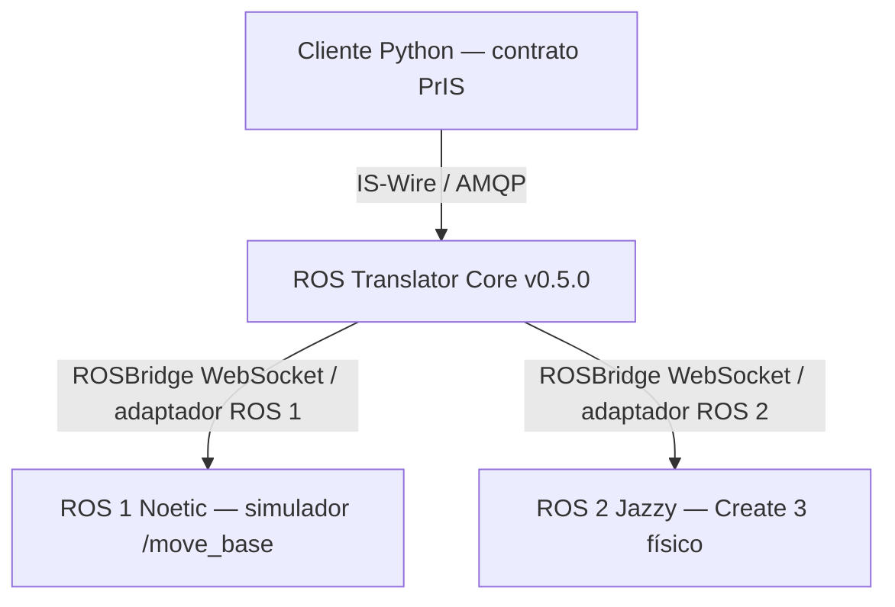

# Relatório técnico-científico: interoperabilidade ROS 1/ROS 2 via ROS Translator v2

**Data da execução:** 25 de novembro de 2026 (UTC)  
**Destinatário:** Prof. Alexandre — revisão do artigo IE 2027  
**Projeto:** IS-ROS-Translator / LabVISIO  
**Identificador da execução:** `20261125T155512Z-c38e81`  
**Resultado:** **E1 e E2 aprovados na execução observada; missão física global não concluída devido ao aborto da ação de docking.**

> **Síntese para revisão:** O experimento comprova que um cliente PrIS/IS-Wire utiliza a mesma interface semântica para solicitar tarefas a backends ROS 1 e ROS 2, que os adaptadores específicos encaminham os objetivos às respectivas ações ROS e que uma única requisição `follow_waypoints` por backend produz duas ações ordenadas, com estados terminais e resposta correlacionados. A execução não mede precisão de posicionamento, desempenho de comunicação ou confiabilidade estatística, nem implementa comunicação direta entre os dois ROS.

## 1. Objetivo e critérios de aceitação

O recorte experimental é **comunicação, tradução semântica e encaminhamento de tarefas**, não avaliação de controle, planejamento, navegação autônoma ou precisão física. Foram verificadas duas capacidades do tradutor:

| Ensaio | Pergunta experimental | Critério funcional |
| --- | --- | --- |
| **E1 — `navigate`** | O mesmo contrato PrIS/IS-Wire é encaminhado a ROS 1 e ROS 2 por seus adaptadores específicos? | Comandos com a mesma estrutura semântica, objetivos correspondentes, registros de despacho e respostas terminais de sucesso nos dois backends. |
| **E2 — `follow_waypoints`** | Uma única requisição PrIS contendo dois objetivos é executada em ordem por cada backend? | Uma requisição correlacionada por backend; índices `0` e `1`; primeiro resultado terminal antes do segundo despacho; `completed_waypoints=2`; dois resultados terminais bem-sucedidos. |

O Create 3 físico acrescenta evidência em hardware real, mas **seu acoplamento à base não é critério de aceitação de E1/E2**. Eventuais tempos de execução abrangem deslocamento e espera pelas ações ROS; não são apresentados como latência de transporte.

## 2. Arquitetura e execução



- O cliente Python foi executado **na máquina Ubuntu**, fora dos contêineres, e utilizou exclusivamente IS-Wire para as requisições e a telemetria recebida. O Core, ambos os ROSBridges e RabbitMQ estavam em contêineres Docker.
- O cliente coordenou a execução espelhada **sequencial**: primeiro a ação simulada ROS 1 e depois a ação correspondente no Create 3. Não houve atuação simultânea dos dois robôs nem comunicação ROS 1 ↔ ROS 2 direta.
- ROS 1 recebeu os pontos no referencial `map`; ROS 2 recebeu os pontos no referencial `odom`. Os valores numéricos foram transformados pelo cliente, enquanto a **estrutura semântica do comando** permaneceu comum.
- A operação `follow_waypoints` é implementada no Core como duas ações ROS ordenadas dentro de uma única requisição PrIS, usando o adaptador do backend selecionado.

### Parâmetros reprodutíveis

| Parâmetro | Valor registrado |
| --- | --- |
| Modo | `physical-e2e` |
| Aleatoriedade | `--seed 2027` |
| ROS 1 espelhado | `--ros1-mirror` |
| Sequenciamento E2 | `--validate-follow-waypoints` |
| Quantidade de ciclos | 5 |
| Base física nominal no plano | `(1.5, -1.0)` m |
| Conversão configurada | `odom_x = map_x - 1.5`; `odom_y = map_y + 1.0` |
| Aproximação nominal da base | `odom=(-0.2, 0.0)` m |
| Revisão Git reportada pelo cliente | `0761fbffdda4b63a0a600c9896afcb3deb181645` |
| Estado do checkout | **`git_dirty: true` — alterações locais ainda não identificadas** |
| Python do cliente | `3.10.12` |
| Bibliotecas | `is-wire 1.2.1`; `is-msgs 1.1.18`; `protobuf 3.20.3` |

Comando registrado, executável **somente sob supervisão física, área livre e parada manual disponível**:

```bash
python3 create3_physical_e2e.py \
  --execute --confirm-area-clear \
  --ros1-mirror --validate-follow-waypoints --seed 2027
```

## 3. Evidências coletadas e método de auditoria

Foram confrontadas as seguintes fontes da execução `20261125T155512Z-c38e81`:

1. **`summary.json`** — parâmetros, versão, desfecho global e validações resumidas.
2. **`wire_requests.jsonl`** — requisições do cliente, respostas, `request_id`, `correlation_id`, duração ponta a ponta da operação e identificadores retornados.
3. **`events.jsonl`** — sequência observada pelo cliente, incluindo os cinco ciclos, os dois E2 e a tentativa final de docking.
4. **`core_bridge_events.jsonl`** — eventos instrumentados do IS-Wire, Core, transporte ROSBridge e adaptadores, com `at_utc` e `monotonic_ns`.

O arquivo do Core é **append-only** e também contém registros de tentativas anteriores. Para esta auditoria foram considerados os IDs associados à execução iniciada às **15:55:12 UTC** e encerrada às **15:57:36 UTC**, sem misturar o `check-only` anterior das 15:45.

### 3.1. Integridade da correlação cliente ↔ Core

| Medida observada | Resultado |
| --- | ---: |
| Requisições registradas no cliente | **52** |
| Requisições com `request_id` **e** `correlation_id` correspondentes a `iswire.request_received` no Core | **52/52** |
| Requisições com resposta terminal correspondente (`reply_prepared` ou `request_rejected`) no Core | **52/52** |
| Respostas funcionais de sucesso | **50** |
| Respostas funcionais de erro explícito | **2** |

As duas respostas de erro correspondem ao `dock` físico abortado e à tentativa de serviço `e_stop` negada pela política de acesso. Portanto, **52/52 é a taxa de pareamento observada dos registros nesta execução**, e não uma estimativa estatística de confiabilidade de rede nem uma afirmação de que todas as operações foram bem-sucedidas.

### 3.2. E1 — encaminhamento aos dois mecanismos ROS

| Backend | Requisições simples `navigate` | Objetivos dentro do E2 | Objetivos de navegação com estado de sucesso |
| --- | ---: | ---: | ---: |
| ROS 1 simulado (`/move_base`) | 9 | 2 | **11/11** — estado terminal `3` |
| ROS 2 físico (`/create3/navigate_to_position`) | 9 | 2 | **11/11** — estado terminal `4` |

Foram conferidos os **11 pares** de objetivos preparados pelo Core. Em todos eles, a diferença entre os valores do ROS 1 (`map`) e do ROS 2 (`odom`) corresponde à transformação configurada: `map_x - odom_x = 1.5 m` e `map_y - odom_y = -1.0 m`, ressalvadas representações decimais de ponto flutuante. Isso verifica a **tradução dos parâmetros enviados**, sem medir precisão física ou equivalência de trajetórias executadas.

O encadeamento instrumental observado para cada objetivo é:

`iswire.request_received` → `core.navigation_goal_prepared` → `bridge.action_dispatched` → `ros1_adapter|ros2_adapter.goal_sent` → `goal_terminal` → `bridge.action_completed` → `core.navigation_goal_completed` → `iswire.reply_prepared`.

### 3.3. E2 — duas ações ROS em uma requisição PrIS

| Campo verificado | ROS 1 | ROS 2 |
| --- | --- | --- |
| `robot_id` | `ros1_sim` | `create_3` |
| `request_id` | `fe6a2bec-4822-4bc3-9b90-018a63b2cf33` | `8ad72a67-9270-47a5-b0fd-535c1e87b474` |
| `correlation_id` | `12888410441696824893` | `76297443242035881` |
| Requisições `follow_waypoints` | **1** | **1** |
| Objetivos na requisição | **2** | **2** |
| `completed_waypoints` | **2** | **2** |
| Estados terminais recebidos | `[3, 3]` | `[4, 4]` |
| Identificadores de objetivos retornados | **2** | **2** |
| Ordem pelo relógio monotônico do Core | **Confirmada** | **Confirmada** |

Em ambos os backends, os registros mostram:

1. `sequence_started`;
2. `sequence_step_started` para `waypoint_index=0`;
3. `sequence_step_completed` para o índice `0`;
4. `sequence_step_started` para `waypoint_index=1`;
5. `sequence_step_completed` para o índice `1`;
6. `sequence_completed` e resposta correlacionada, com `completed_waypoints=2`.

O segundo `sequence_step_started` ocorre depois do primeiro `sequence_step_completed` por aproximadamente **0,083 ms (ROS 1)** e **0,085 ms (ROS 2)**, conforme os `monotonic_ns` capturados **no mesmo processo do Core**. Estes intervalos **não** são latência de rede, nem justificam comparação de desempenho entre ROS 1 e ROS 2; servem apenas para confirmar a ordenação dos eventos registrados.

Os `goal_id` são identificadores disponibilizados pelos clientes de ação ROS/ROSBridge utilizados nesta execução. Não foi realizada uma verificação independente de UUIDs nativos no servidor de ações ROS 2.

### 3.4. Corroboração da execução completa dos cinco ciclos

O `events.jsonl` do cliente contém **cinco** eventos `loop_pass` e dois eventos `follow_waypoints_verified` (um por backend). O campo `validation` de `summary.json` informa:

```json
{
  "E1_navigate_ros1": "PASS",
  "E1_navigate_ros2": "PASS",
  "E2_follow_waypoints_ros1": "PASS",
  "E2_follow_waypoints_ros2": "PASS",
  "IS_Wire_request_reply_correlation": "PASS",
  "backend_goal_ids": "PASS",
  "independent_adapter_routing": "NOT_VERIFIED_FROM_CLIENT_ALONE"
}
```

O último campo delimita corretamente o que **somente o cliente** pode atestar. O arquivo complementar `core_bridge_events.jsonl` contém eventos específicos `ros1_adapter` e `ros2_adapter` para os mesmos IDs, corroborando o encaminhamento por adaptadores distintos. Essa corroboração ainda é uma **observação instrumentada no Core**, não uma captura externa de pacotes DDS ou dos logs internos de ambos os servidores de ação.

## 4. Falha de docking e tratamento de erro

O resultado **global** da missão está corretamente marcado como `status: failed` no `summary.json`. Depois dos cinco ciclos concluídos:

1. A ação de aproximação foi concluída com sucesso pelo ROS 2.
2. Antes do `dock`, o cliente registrou `dock_visible: false` e avisou que a operação poderia falhar.
3. Às **15:57:35.967 UTC**, a ação `/create3/dock` retornou `GoalStatus.ABORTED`, estado terminal `6`.
4. O adaptador e a camada de transporte registraram `action_failed`/`request_rejected`; o cliente recebeu o erro correspondente.
5. A tentativa subsequente de `/create3/e_stop` via `ros.service` foi recusada como `forbidden` pela política de acesso. **Não existe confirmação de parada de emergência remota.**

O motivo físico exato do aborto de docking não foi estabelecido pelos logs disponíveis. **Não se atribui a falha à tradução nem ao transporte sem evidência adicional.** O retorno do erro é, por si só, uma observação válida do mecanismo de propagação de falhas do tradutor. O acoplamento físico não foi comprovado nesta execução.

**Segurança operacional:** confirmar o estado atual do robô e utilizar os meios físicos de parada necessários antes de qualquer nova movimentação. A missão não deve ser descrita como globalmente aprovada.

## 5. Conclusões defensáveis e limites

**Comprovado nesta execução (funcional, N=1):**

- O contrato semântico comum foi traduzido e encaminhado a ROS 1 e ROS 2 por adaptadores distintos, com objetivos correspondentes e resultados terminais de sucesso.
- Uma única requisição `follow_waypoints` por backend gerou duas ações ordenadas e uma resposta final com `completed_waypoints=2`.
- Todas as 52 requisições do cliente puderam ser vinculadas aos registros de recebimento e resposta no Core, incluindo as duas respostas explícitas de erro.
- O cliente recebeu e interpretou os resultados de ações retornados pelo backend correspondente.

**Não comprovado e não reivindicado:**

- Comunicação ROS 1 ↔ ROS 2 diretamente, sem mediação do cliente/PrIS.
- Execução simultânea de robôs, concorrência distribuída ou garantia *exactly-once*.
- Precisão de odometria, equivalência geométrica real, segurança de navegação ou planejamento de obstáculos.
- Latência intrínseca de comunicação, throughput, comparação de desempenho ROS 1 versus ROS 2 ou confiabilidade estatística.
- Sucesso físico de docking ao final desta missão.
- Identidade com uma versão estritamente limpa do repositório: `git_dirty` permaneceu `true` e seu conteúdo precisa ser inspecionado.

## 6. Rastreabilidade e pendências para arquivamento

| Artefato | Situação nesta revisão | Ação recomendada |
| --- | --- | --- |
| `summary.json` | Recebido e analisado | Arquivar com o identificador da execução |
| `wire_requests.jsonl` | Recebido; 52 registros correlacionados | Preservar integralmente em armazenamento de pesquisa |
| `events.jsonl` | Recebido; cinco ciclos e E2 identificados | Preservar integralmente em armazenamento de pesquisa |
| `core_bridge_events.jsonl` | Recebido; eventos de Core, ROSBridge e adaptadores identificados | Preservar a cópia da sessão e filtrar por IDs da execução |
| Revisão Git | SHA registrado | Guardar `git status --short` e, se houver alterações relevantes, o respectivo diff |
| Ambiente | Versões do cliente identificadas | Manter configuração efetiva do Compose/FastDDS e versões das imagens |
| Segurança | Serviço remoto de `e_stop` negado | Registrar procedimento físico de parada; não inferir parada remota |

Os dados brutos mencionados acima foram fornecidos para esta revisão, mas **não foram publicados junto com este relatório**. Sua publicação exige avaliação prévia de coordenadas físicas, identificadores operacionais e eventuais dados sensíveis. Sem o conjunto bruto anexado, terceiros podem avaliar os resultados consolidados e exemplos de rastreabilidade, mas não executar uma auditoria completa independente.

### Redação recomendada para o artigo

> Em uma execução integrada com um simulador ROS 1 e um iRobot Create 3 físico via ROS 2, o ROS Translator v2 processou 20 requisições semânticas de navegação (`18 navigate` e `2 follow_waypoints`) por IS-Wire, resultando em 22 objetivos ROS concluídos com sucesso. Cada requisição `follow_waypoints` continha dois objetivos, executados na ordem observada pelo Core, com estados terminais e resposta final correlacionados. As 52 requisições de todos os tipos realizadas pelo cliente foram associadas a eventos de entrada e resposta no Core. O docking físico final foi abortado pelo backend ROS 2, e o erro foi propagado corretamente ao cliente. Esses resultados sustentam a interoperabilidade funcional e a composição sequencial de tarefas; não constituem avaliação de precisão de navegação ou de desempenho do transporte.

## 7. Extensão do protocolo — E3: destinos diferentes em execução concorrente (a executar)

O protocolo E3 foi ampliado **após** a sessão de 15:55 UTC para examinar uma
capacidade ainda não observada em E1/E2: **sequências independentes de
navegação concorrente em ROS 1 e ROS 2, com destinos intencionalmente
distintos**, intercaladas com retornos à origem.

São **cinco ciclos**, cada um com duas fases executadas em ordem:

1. ROS 1 recebe um destino próprio e ROS 2 um destino diferente, por duas
   requisições `navigate` emitidas simultaneamente.
2. Após ambas as ações terminarem, os dois backends recebem, também
   simultaneamente, uma navegação de retorno ao ponto físico `(0,0)`.
3. A próxima rodada começa apenas quando ambos os retornos terminam.

Isso totaliza **20 requisições de navegação**, dez para cada backend, em
**dez pares concorrentes** (cinco destinos e cinco retornos). Os destinos
dos ciclos 2–5 são gerados de forma determinística por `--seed 2027`,
mantendo distância mínima de 0,5 m entre os dois alvos de cada ciclo.

| Propriedade | ROS 1 (`ros1_sim`) | ROS 2 (`create_3`) |
| --- | --- | --- |
| Destino inicial, ciclo 1, referencial físico (m) | **(-0.8, +0.6)** | **(+0.8, -0.6)** |
| Referencial da ação | `map` | `odom` |
| Posição inicial solicitada (m) | **(-0.8, +0.6)** | **(-0.7, +0.4)**, após a transformação nominal do cliente |
| Retorno a cada ciclo (m) | `map=(0,0)` | `odom=(-1.5,+1.0)` |
| Executor | Simulador ROS 1 `/move_base` | Create 3 físico, ação ROS 2 `/create3/navigate_to_position` |

Duas threads do cliente, sincronizadas por barreira **em cada fase**, enviam
chamadas IS-Wire `navigate` separadas. Cada uma gera `robot_id`, `request_id`,
`correlation_id`, `goal_id` e horário de envio/conclusão identificáveis.
O objetivo de E3 é
avaliar **concorrência e independência de roteamento**, não proximidade entre
trajetórias, exatidão de pose ou coordenação física entre robôs.

Executar no host Ubuntu, sob supervisão e com área livre:

```bash
# Inspecionar os cinco pares de destinos/retornos, sem movimentação:
python3 create3_physical_e2e.py --plan-parallel-goals --seed 2027

# Executar os cinco ciclos em hardware:
python3 create3_physical_e2e.py \
  --parallel-goals-only --confirm-area-clear --seed 2027
```

Esse modo realiza cinco ciclos adicionais de movimentação do Create 3,
podendo desacoplar da base, e **não realiza docking automático**. Como
alternativa, o protocolo completo aceita
`--execute --confirm-area-clear --ros1-mirror --validate-follow-waypoints
--validate-parallel-goals --seed 2027` para incluir E3 após os cinco ciclos e
antes da tentativa final de docking. O destino físico e a geometria das
trajetórias não são usados como critério de precisão; verificam-se os
comandos, os encaminhamentos e seus estados terminais.

**Critério de validação:** o cliente registra horários monotônicos de cada par
de requisições sobrepostas, mas isso **não basta** para sustentar que as ações
ROS ocorreram em paralelo. O verificador adicional `verify_e3_overlap.py`
cruza os **20 IDs** de `wire_requests.jsonl` com `core_bridge_events.jsonl`,
exige todos os estados terminais de sucesso, os retornos na ordem correta e
calcula a interseção temporal dos intervalos
`goal_sent` → `goal_terminal` dos adaptadores ROS 1 e ROS 2, usando o relógio
monotônico do Core. Somente uma interseção positiva **em cada um dos dez
pares**, com registros completos, produz um `e3_overlap_verification.json`
com `status=PASS`.

Uma etapa diagnóstica auxiliar **H1**, já implementada, testa operações de
tipos diferentes sem movimento (`get_map` no ROS 1 e `get_odometry` no ROS 2):

```bash
python3 create3_physical_e2e.py --distinct-commands-only --seed 2027
```

H1 é distinto do E3 e não substitui a evidência de requisições de navegação
concorrentes. Sua execução antecede automaticamente o movimento no modo
completo quando `--ros1-mirror` está ativo.

**Estado científico:** E3 e H1 não integraram a execução original
`20261125T155512Z-c38e81`, cujas contagens e conclusões nas seções anteriores
permanecem inalteradas. Uma versão preliminar de E3 com **apenas um par** foi
executada às 16:53 UTC (`20261125T165346Z-b77da1`), com sucesso nas duas
respostas do cliente e 2.638,172 ms de sobreposição de requisições. A
auditoria do Core para esse par permaneceu **inconclusiva**, pois o arquivo de
evidências indicado não continha os novos eventos, com indício de problema
de permissões de escrita. Essa sessão preliminar **não comprova
simultaneidade das ações ROS** e não valida a nova sequência de cinco ciclos.
Uma execução completa da nova versão, com os arquivos brutos de cliente e
Core e verificação E3, ainda é necessária.

---

**Veredito para revisão do Prof. Alexandre:** evidências **suficientes para sustentar E1 e E2 como validação funcional da comunicação e da tradução entre dois backends ROS** nesta execução, condicionadas à preservação dos arquivos brutos e do estado do código. A execução física completa **não** deve ser denominada *PASS* em razão do docking abortado. A documentação do Core complementa explicitamente as limitações de observação do cliente.
